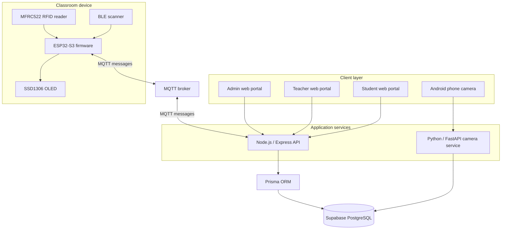
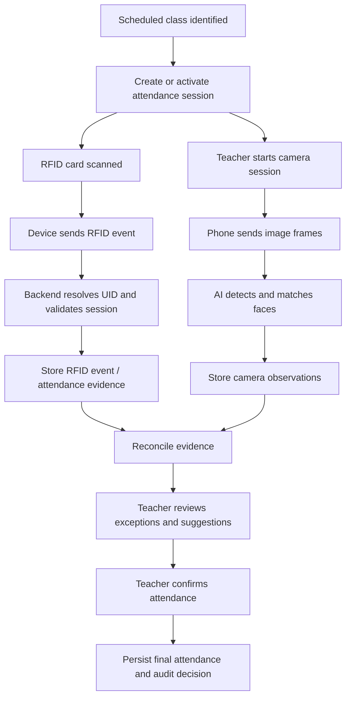

# RollSync — System Architecture

> **Document status:** Updated from the repository documentation, the Prisma schema, and the firmware source inspected for this revision.  
> **Last updated:** 10 November 2026  
> **Status convention:** `Implemented in source` does not mean `integration tested` or `production verified`.

## 1. Project overview

RollSync is a smart classroom attendance system designed to combine RFID-based student identification, classroom camera-based face recognition, teacher review, and web-based attendance management.

The intended product has four main layers:

1. **Client layer:** Admin, teacher, and student web portals, plus an Android phone used as a classroom camera.
2. **Application services:** A Node.js/Express application for core application logic and a Python/FastAPI service for camera and face-recognition processing.
3. **IoT layer:** An ESP32-S3 device connected to an MFRC522 RFID reader and an SSD1306 OLED display. The inspected firmware also includes BLE scanning.
4. **Data and messaging layer:** Supabase PostgreSQL accessed through Prisma, and an MQTT broker for device communication.

This document distinguishes the intended architecture from what has been verified in source. Hosting choices and end-to-end connectivity must be checked against the current deployment configuration before production use.

## 2. Technology stack

| Layer | Technology evidenced in repository or project documentation | Notes |
|---|---|---|
| Web frontend | React 19, Vite, TypeScript, Tailwind CSS | Dependencies are declared in `frontend/package.json`. |
| Frontend data/UI | React Router, TanStack Query, Axios, Supabase JS, Recharts | Actual usage should be confirmed at component level. |
| Main backend | Node.js, Express 5, TypeScript | Dependencies and scripts are declared in `backend/package.json`. |
| ORM | Prisma 5 | Schema at `backend/prisma/schema.prisma`. |
| Database | PostgreSQL on Supabase | `DATABASE_URL` and `DIRECT_URL` are used by Prisma. |
| IoT messaging | MQTT via `mqtt` in backend and PubSubClient in firmware | Exact topic/payload agreement requires validation. |
| Firmware | PlatformIO, Arduino framework, ESP32-S3 | `firmware/platformio.ini`. |
| RFID | MFRC522 | Firmware includes `MFRC522.h`. |
| Display | Adafruit SSD1306 and Adafruit GFX | Firmware initializes an SSD1306 at I²C address `0x3C`. |
| BLE | ESP32 BLE Arduino APIs | BLE scan implementation exists in inspected firmware. |
| Camera/AI | Python, FastAPI, InsightFace, OpenCV | Described by `PROGRESS.md`; inspect the AI service source before assuming current operational status. |

## 3. Logical component architecture

**Important:** The diagram describes the target logical arrangement. The inspected architecture document previously stated that ESP32 used REST over Wi-Fi, while the firmware and MQTT contract describe MQTT. The firmware source imports and uses PubSubClient, so MQTT is the protocol evidenced by the inspected firmware. Confirm the backend's actual MQTT subscription and topic configuration before treating the device-to-backend link as integrated.

## 4. Service responsibilities

### 4.1 Frontend

The frontend is a React + Vite application in `frontend/`.

The project documentation describes three portals:

- **Admin:** student management, class scheduling, and face-training/enrollment-related workflows.
- **Teacher:** class/attendance monitoring, manual review, and camera attendance workflows.
- **Student:** personal attendance information, face registration, attendance history, notifications, and settings.

The existence of UI screens does not by itself prove that every screen is connected to live APIs or production data.

### 4.2 Main backend

The main backend is a Node.js/Express application in `backend/`, using TypeScript and Prisma.

Its intended responsibilities are:

- Serve application APIs to the frontend.
- Apply attendance and timetable business rules.
- Resolve RFID UIDs to student identities.
- Create and manage attendance sessions.
- Persist attendance and device events.
- Coordinate device acknowledgements and status.
- Provide data for the admin, teacher, and student portals.

The inspected `backend/package.json` defines `dev`, `build`, `start`, and `postinstall` scripts. It also defines a `test` script that currently exits with an error indicating no test is specified.

### 4.3 AI camera service

Project documentation describes a separate Python/FastAPI service using InsightFace (Buffalo_L) and OpenCV.

Its intended responsibilities are:

1. Receive a camera image/frame.
2. Detect faces.
3. Extract facial embeddings.
4. Compare embeddings with enrolled face profiles.
5. Record camera observations or return recognition results for attendance review.

The `face_profiles`, `camera_sessions`, and `camera_observations` models exist in the inspected Prisma schema. The Python service's live routes, database access method, and deployment are not independently verified in this documentation update.

### 4.4 ESP32-S3 firmware

The firmware is in `firmware/` and uses PlatformIO with the Arduino framework.

The inspected `firmware/src/main.cpp` includes:

- Wi-Fi connection.
- MQTT connection and reconnect logic.
- MFRC522 RFID scanning.
- SSD1306 OLED initialization and status display.
- BLE scanning.
- Periodic heartbeat publishing.
- RFID and BLE MQTT publishing.

The firmware source currently uses configuration constants from `config.h`. Do not place real Wi-Fi or MQTT secrets in documentation or source control.

### 4.5 Database

The Prisma schema is the authoritative model reference at `backend/prisma/schema.prisma`. It defines the student, teacher, timetable, device, RFID, attendance, face-recognition, audit, and demo-class data structures.

See [DATABASE_SCHEMA.md](DATABASE_SCHEMA.md).

## 5. Intended attendance lifecycle

The workflow is a product-level target. The exact automatic reconciliation policy, thresholds, and final status transitions must be verified in backend source before being treated as implemented.

## 6. RFID event flow

1. A student presents an RFID card to the MFRC522 reader.
2. Firmware reads the UID and normalizes it to uppercase hexadecimal in the inspected source.
3. Firmware constructs a JSON message and publishes it to the configured RFID topic.
4. The backend should validate the device, UID, active session, and duplicate event conditions.
5. The backend should store the raw event in `rfid_events` and associate it with a student/session when matched.
6. The backend should return an acknowledgement if the current firmware/backend contract supports it.

**Integration caveat:** The inspected firmware source publishes an RFID payload with `type`, `uid`, and `timestamp` fields. The MQTT contract describes a richer `rfid_tap` message with `eventId`, `deviceId`, and `ts`. These formats are not identical and must be reconciled.

## 7. Camera flow

The intended camera flow uses a phone or classroom camera to submit images to the AI service. The service detects and matches faces against enrolled profiles and records observations.

The schema separates:
- `face_profiles`: stored student face embeddings.
- `camera_sessions`: a camera session associated with an attendance session.
- `camera_observations`: per-observation recognition results.

The schema also contains a separate demo workflow (`demo_class_sessions`, `demo_class_roster`, `demo_class_captures`, and `demo_class_attendance`). Do not assume the demo workflow and the general camera workflow are the same implementation.

See [AI_CAMERA_SPEC.md](AI_CAMERA_SPEC.md).

## 8. Deployment topology

The existing architecture documentation describes the following intended hosting:

| Service | Previously documented hosting | Current verification |
|---|---|---|
| Frontend | Vercel | Deployment not verified in this document update. |
| Node.js backend | Render | Deployment not verified in this document update. |
| PostgreSQL | Supabase | Project was previously reported inactive; check current Supabase status. |
| AI camera service | Local / GPU cloud | Hosting not verified. |
| MQTT broker | Broker configured by environment/firmware | Exact active broker and credentials must be checked. |

The backend MQTT subscriber must run as a persistent process. Do not assume a short-lived serverless function can maintain a permanent MQTT subscription.

## 9. Security and privacy requirements

Before production deployment:

- Use role-based authorization for admin, teacher, and student actions.
- Protect database access and configure appropriate Supabase Row Level Security policies.
- Use per-device MQTT credentials and broker topic ACLs.
- Validate and deduplicate device events.
- Use HTTPS for browser and camera traffic.
- Keep secrets in environment variables or a secrets manager.
- Restrict access to biometric embeddings and camera images.
- Define informed consent, retention, deletion, and access policies for biometric data.
- Record teacher overrides and final confirmation in audit logs.
- Avoid sending student names or other unnecessary personal data over MQTT.

## 10. Known architecture discrepancies to resolve

| Area | Discrepancy | Required action |
|---|---|---|
| Device transport | Old architecture says REST; firmware uses MQTT client. | Inspect backend MQTT consumer and choose one documented protocol. |
| MQTT topic | Contract uses `school/att/devices/{deviceId}/...`; old API reference uses `classroom/+/rfid`. | Align firmware constants and backend subscriptions. |
| RFID payload | Firmware source uses `type`, `uid`, `timestamp`; contract uses `eventId`, `deviceId`, `uid`, `ts`. | Agree on a versioned payload and update both ends. |
| GPIO wiring | Old hardware doc lists generic ESP32 pins; recorded S3 wiring differs. | Confirm against `config.h` and physical board. |
| Camera flow | General camera tables and demo-class tables coexist. | Decide which is the production workflow. |
| Deployment | Hosting providers are described but not verified. | Inspect deployment dashboards and health endpoints. |

## 11. Related documentation

- [Database schema](DATABASE_SCHEMA.md)
- [API reference](API_REFERENCE.md)
- [Hardware setup](HARDWARE_SETUP.md)
- [MQTT contract](mqtt-contract.md)
- [Attendance workflow](ATTENDANCE_WORKFLOW.md)
- [AI camera specification](AI_CAMERA_SPEC.md)
- [Deployment guide](DEPLOYMENT_GUIDE.md)
- [Setup guide](SETUP_GUIDE.md)
- [Progress and plan](PROGRESS.md)
