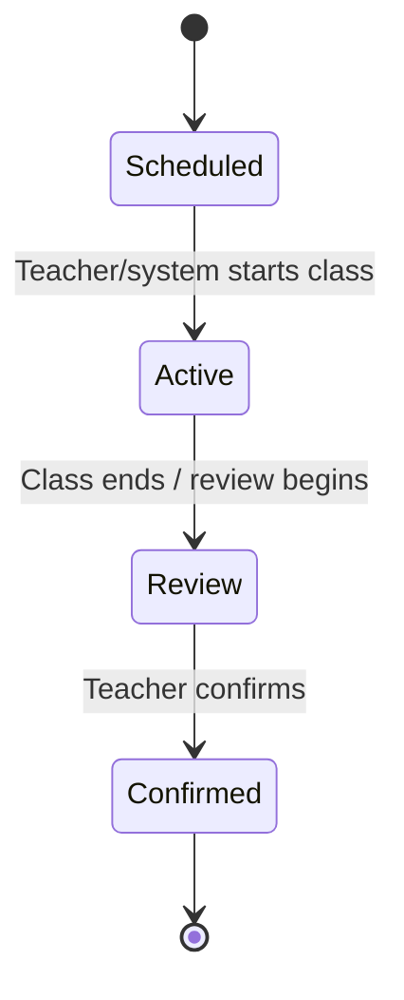

# RollSync — Attendance Workflow

> **Document status:** Product workflow and schema-backed behavior. Exact runtime rules require backend verification.  
> **Last updated:** 10 November 2026

## 1. Purpose

This document describes the intended classroom attendance lifecycle using timetable sessions, RFID events, camera observations, and teacher confirmation.

## 2. Session lifecycle

The Prisma schema defines `attendance_sessions` with:
- `active`
- `status` (default `scheduled`)
- `start_time`, `end_time`
- `actual_start_time`, `actual_end_time`
- `confirmed`, `confirmed_by`, `confirmed_at`

The exact code that creates, activates, closes, and confirms sessions must be checked in backend services.

Suggested lifecycle:

The status names above describe the intended lifecycle; the schema uses a string field and does not enforce this state machine itself.

## 3. RFID workflow

1. Student taps an RFID card.
2. ESP32 reads the UID.
3. Firmware sends an MQTT event.
4. Backend validates device and payload.
5. Backend looks up an active `rfid_cards` record by UID.
6. Backend checks the current classroom and active attendance session.
7. Backend stores an `rfid_events` row.
8. Backend associates the event with student/session if matched.
9. Attendance evidence is created or updated.
10. Device acknowledgement is published if supported by the active protocol.

### RFID outcomes to support

| Outcome | Meaning |
|---|---|
| Matched | UID maps to an active student card |
| Unknown card | UID is not registered |
| Inactive card | Card exists but is deactivated |
| No active session | No valid class session for the device/classroom |
| Duplicate | Event or student/session already recorded |
| Late | Scan falls outside the configured on-time window |
| Error | Processing or infrastructure failure |

These are recommended outcome categories. Confirm exact enum/string values and handling in source.

## 4. Camera workflow

1. Teacher initiates a camera session.
2. Camera client obtains a session token or authorized upload path.
3. Phone sends frames/images to the camera service.
4. AI service detects faces.
5. Service extracts embeddings.
6. Embeddings are compared with enrolled student profiles.
7. Recognition results are associated with the camera session.
8. `camera_observations` records the observation, student (if matched), similarity (if available), detection flag, and status.

The schema also contains a separate demo workflow:
- `demo_class_sessions`
- `demo_class_roster`
- `demo_class_captures`
- `demo_class_attendance`
- `demo_class_audit_logs`

Do not merge these two workflows conceptually until the application code confirms how they are used.

## 5. Multi-frame evidence

The demo attendance schema includes:
- `frames_recognized`
- `valid_frames`
- `ai_classification`
- `teacher_decision`
- `review_status`

The schema comments list AI classifications `Present`, `Absent`, and `Maybe`. It does not define the threshold or frame-count formula. The exact decision rule must be extracted from the AI/backend source.

Do not claim a specific recognition percentage, frame threshold, or confidence threshold unless it is configured in code.

## 6. RFID and camera reconciliation

Proposed teacher-review matrix:

| RFID evidence | Camera evidence | Suggested review outcome |
|---|---|---|
| Present | Present | Strong candidate for Present |
| Present | Not detected | Review required |
| Not detected | Present | Review required |
| Not detected | Not detected | Absent candidate |

This matrix is a recommended policy, not proof that automatic reconciliation is implemented.

RFID proves that a card was scanned; it does not independently prove that the cardholder remained in the classroom. Camera recognition provides visual evidence but can fail due to occlusion, lighting, camera angle, or recognition uncertainty. The system should preserve evidence and allow teacher review.

## 7. Teacher review and confirmation

The intended teacher workflow:

1. Open the active or completed class session.
2. View roster and attendance suggestions.
3. Review RFID events and camera evidence.
4. Resolve ambiguous or conflicting cases.
5. Manually correct status where authorized.
6. Confirm the final attendance.
7. Persist confirmation identity and timestamp.
8. Make confirmed attendance visible to student views.

The schema contains confirmation fields at both session and record level:
- Session: `confirmed`, `confirmed_by`, `confirmed_at`.
- Record: `teacher_confirmed`, `confirmed_by`, `confirmed_at`.

Backend logic must keep these fields consistent or explicitly define their different meanings.

## 8. Duplicate and idempotency rules

The schema enforces:
- Unique `(session_id, student_id)` on `attendance_records`.
- Optional unique `event_id` on `rfid_events`.
- Unique `(session_id, student_id)` on demo roster and demo attendance.

Recommended processing:
- Use event IDs to deduplicate retransmitted device messages.
- Do not create multiple final attendance rows for one student/session.
- Preserve repeated scans in raw event history if auditability is needed.
- Update first/last scan timestamps rather than duplicating final records.

## 9. Privacy and fairness

- Use biometric processing only with appropriate notice and consent.
- Limit who can view face profiles and images.
- Provide a correction path for false negatives.
- Do not automatically penalize students based only on uncertain recognition.
- Define data retention and deletion.
- Keep teacher overrides auditable.

## 10. Verification checklist

- [ ] Session is created for the correct timetable slot.
- [ ] Device is associated with correct classroom.
- [ ] Active session validation works.
- [ ] Active RFID card resolves to correct student.
- [ ] Inactive/unknown card is rejected.
- [ ] Duplicate event is idempotent.
- [ ] Camera session belongs to the correct attendance session.
- [ ] Observations are associated with correct student/session.
- [ ] Ambiguous recognition is reviewable.
- [ ] Teacher can correct a suggested result.
- [ ] Teacher confirmation is persisted.
- [ ] Student portal reflects confirmed attendance.
