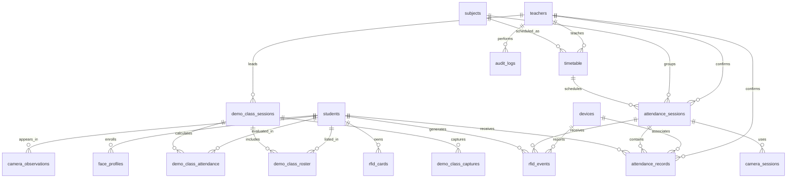

# RollSync — Database Schema

> **Source of truth:** `backend/prisma/schema.prisma`  
> **Database:** PostgreSQL (intended hosting: Supabase)  
> **ORM:** Prisma  
> **Last updated:** 10 November 2026

## 1. Overview

The database is defined by the Prisma schema in `backend/prisma/schema.prisma`. The schema inspected for this update contains **18 models**:

1. `attendance_records`
2. `attendance_sessions`
3. `devices`
4. `rfid_cards`
5. `students`
6. `subjects`
7. `teachers`
8. `timetable`
9. `face_profiles`
10. `camera_sessions`
11. `camera_observations`
12. `rfid_events`
13. `audit_logs`
14. `demo_class_sessions`
15. `demo_class_roster`
16. `demo_class_captures`
17. `demo_class_attendance`
18. `demo_class_audit_logs`

Field names and types below follow the inspected Prisma schema. Confirm live database migrations and deployed schema separately; the Prisma file does not prove that the live Supabase database is synchronized.

## 2. Entity relationship overview



The diagram summarizes the main relations. The detailed model definitions below are authoritative.

## 3. Model reference

### 3.1 `students`

Purpose: central student identity and academic information.

| Field | Type | Notes |
|---|---|---|
| `id` | String / UUID | Primary key; generated UUID |
| `roll_number` | String | Unique |
| `ug_no` | String? | Optional university number |
| `name` | String | Student name |
| `email` | String? | Optional |
| `department` | String? | Optional |
| `semester` | Int? | Optional |
| `section` | String? | Optional |
| `active` | Boolean | Defaults to `true` |
| `created_at` | DateTime | Defaults to now |
| `updated_at` | DateTime | Updated automatically |

Relations: RFID cards, RFID events, attendance records, face profiles, camera observations, demo roster, and demo attendance.

### 3.2 `teachers`

Purpose: teacher identity and role information.

| Field | Type | Notes |
|---|---|---|
| `id` | String / UUID | Primary key |
| `auth_id` | String? / UUID | Optional unique auth identity |
| `name` | String | Unique |
| `email` | String? | Optional unique |
| `department` | String? | Optional |
| `role` | String? | Defaults to `teacher` |
| `created_at` | DateTime | Defaults to now |

Relations: timetable entries, confirmed sessions, confirmed attendance records, audit logs, demo sessions, and demo audit logs.

### 3.3 `subjects`

| Field | Type | Notes |
|---|---|---|
| `id` | String / UUID | Primary key |
| `subject_code` | String? | Optional unique |
| `subject_name` | String | Required |
| `created_at` | DateTime | Defaults to now |

Relations: timetable and attendance sessions.

### 3.4 `timetable`

| Field | Type | Notes |
|---|---|---|
| `id` | String / UUID | Primary key |
| `day` | String | Day identifier |
| `start_time` | String | Scheduled start |
| `end_time` | String | Scheduled end |
| `subject_id` | String / UUID | FK to `subjects.id` |
| `teacher_id` | String / UUID | FK to `teachers.id` |
| `section` | String | Class section |
| `room` | String | Classroom |
| `class_type` | String? | Optional class type |
| `is_lab` | Boolean | Defaults to `false` |
| `active` | Boolean | Defaults to `true` |
| `created_at` | DateTime | Defaults to now |

Indexes: `teacher_id`, `day`, and `section`.

### 3.5 `attendance_sessions`

Purpose: a scheduled or active attendance instance for a subject/class.

| Field | Type | Notes |
|---|---|---|
| `id` | String / UUID | Primary key |
| `subject_id` | String / UUID | FK to subject |
| `timetable_id` | String? / UUID | Optional FK to timetable |
| `classroom` | String | Classroom identifier |
| `start_time` | DateTime | Session start |
| `end_time` | DateTime | Session end |
| `active` | Boolean | Defaults to `false` |
| `class_date` | DateTime / Date | Defaults to current date |
| `actual_start_time` | DateTime? | Actual start |
| `actual_end_time` | DateTime? | Actual end |
| `status` | String | Defaults to `scheduled` |
| `confirmed` | Boolean | Defaults to `false` |
| `confirmed_by` | String? / UUID | Optional teacher FK |
| `confirmed_at` | DateTime? | Confirmation timestamp |
| `created_at` | DateTime | Defaults to now |

Unique constraint: `(timetable_id, class_date)`. Index: `active`.

### 3.6 `attendance_records`

Purpose: consolidated student attendance record for a session.

| Field | Type | Notes |
|---|---|---|
| `id` | String / UUID | Primary key |
| `student_id` | String / UUID | FK to student |
| `session_id` | String / UUID | FK to attendance session |
| `device_id` | String? / UUID | Optional device FK |
| `timestamp` | DateTime | Defaults to now |
| `status` | String | Defaults to `present` |
| `source` | String | Defaults to `rfid` |
| `created_at` | DateTime | Defaults to now |
| `updated_at` | DateTime | Updated automatically |
| `first_scan_at` | DateTime? | Optional first scan |
| `last_scan_at` | DateTime? | Optional last scan |
| `face_verification_summary` | Json? | Optional summary |
| `teacher_confirmed` | Boolean | Defaults to `false` |
| `confirmed_by` | String? / UUID | Optional teacher FK |
| `confirmed_at` | DateTime? | Optional confirmation time |

Unique constraint: `(session_id, student_id)`. Indexes: `session_id`, `student_id`, and `timestamp`.

### 3.7 `devices`

| Field | Type | Notes |
|---|---|---|
| `id` | String / UUID | Primary key |
| `device_id` | String | Unique device identifier |
| `device_name` | String | Device display name |
| `classroom` | String? | Optional classroom |
| `mqtt_topic` | String | Configured MQTT topic |
| `status` | String | Defaults to `offline` |
| `last_seen` | DateTime? | Last heartbeat/seen time |
| `created_at` | DateTime | Defaults to now |

Relations: RFID events and attendance records.

### 3.8 `rfid_cards`

| Field | Type | Notes |
|---|---|---|
| `id` | String / UUID | Primary key |
| `uid` | String | Unique card UID |
| `student_id` | String / UUID | FK to student |
| `active` | Boolean | Defaults to `true` |
| `deactivated_at` | DateTime? | Optional deactivation time |
| `created_at` | DateTime | Defaults to now |

Index: `student_id`. A student may have multiple card records in the schema.

### 3.9 `rfid_events`

Purpose: raw or processed RFID scan event history.

| Field | Type | Notes |
|---|---|---|
| `id` | String / UUID | Primary key |
| `event_id` | String? | Optional unique event ID |
| `device_id` | String? / UUID | Optional FK to device |
| `uid` | String | Scanned UID |
| `student_id` | String? / UUID | Optional matched student |
| `student_name_snapshot` | String? | Optional name snapshot |
| `classroom` | String? | Optional classroom |
| `event_timestamp` | DateTime | Device/event time |
| `server_timestamp` | DateTime | Defaults to now |
| `mqtt_topic` | String? | Topic received |
| `raw_payload` | Json? | Original payload |
| `session_id` | String? / UUID | Optional attendance session FK |
| `processing_status` | String | Defaults to `pending`; comment lists `pending`, `matched`, `unmatched`, `error` |
| `review_reason` | String? | Optional review explanation |

Unique constraint: optional `event_id`. Indexes: `uid`, `event_timestamp`.

### 3.10 `face_profiles`

| Field | Type | Notes |
|---|---|---|
| `id` | String / UUID | Primary key |
| `student_id` | String / UUID | FK to student |
| `embedding` | Float[] | Facial embedding values |
| `reference_count` | Int | Defaults to `0` |
| `created_at` | DateTime | Defaults to now |
| `updated_at` | DateTime | Defaults to now in schema |

No unique constraint on `student_id` is declared in the inspected schema.

### 3.11 `camera_sessions`

| Field | Type | Notes |
|---|---|---|
| `id` | String / UUID | Primary key |
| `attendance_session_id` | String / UUID | FK to attendance session |
| `token` | String | Unique |
| `camera_type` | String | Defaults to `demo_phone` |
| `status` | String | Defaults to `active` |
| `expires_at` | DateTime | Required |
| `created_at` | DateTime | Defaults to now |

### 3.12 `camera_observations`

| Field | Type | Notes |
|---|---|---|
| `id` | String / UUID | Primary key |
| `session_id` | String / UUID | FK to camera session |
| `student_id` | String? / UUID | Optional FK to student |
| `detected` | Boolean | Defaults to `true` |
| `similarity` | Float? | Optional match score |
| `status` | String | Recognition/observation status |
| `created_at` | DateTime | Defaults to now |

### 3.13 `audit_logs`

| Field | Type | Notes |
|---|---|---|
| `id` | String / UUID | Primary key |
| `actor_id` | String? / UUID | Optional FK to teacher |
| `action` | String | Action name |
| `entity_type` | String | Entity category |
| `entity_id` | String? / UUID | Optional entity UUID |
| `reason` | String? | Optional reason |
| `before_state` | Json? | Optional previous state |
| `after_state` | Json? | Optional new state |
| `timestamp` | DateTime | Defaults to now |

### 3.14 `demo_class_sessions`

Purpose: separate demo classroom capture/attendance workflow.

Fields: `id`, `teacher_id`, `section` (default `SEC B`), `classroom` (default `RDB 6`), `duration_minutes` (default `3`), `status` (default `waiting`), unique `token`, optional `started_at`, `ended_at`, `confirmed_at`, and `created_at`.

The schema comment lists demo statuses: `waiting`, `in_progress`, `processing`, `review_ready`, `confirmed`.

### 3.15 `demo_class_roster`

Fields: `id`, `session_id`, `student_id`, `name`, `roll_number`, `created_at`.

Unique constraint: `(session_id, student_id)`.

### 3.16 `demo_class_captures`

Fields: `id`, `session_id`, `capture_number`, `status` (default `pending`), optional JSON `results`, `created_at`, optional `processed_at`.

Unique constraint: `(session_id, capture_number)`. Commented statuses: `pending`, `processing`, `success`, `failed`.

### 3.17 `demo_class_attendance`

Fields: `id`, `session_id`, `student_id`, `frames_recognized` (default `0`), `valid_frames` (default `0`), `ai_classification`, optional `teacher_decision`, `review_status` (default `pending`), `created_at`, `updated_at`.

Unique constraint: `(session_id, student_id)`. Schema comments describe AI classifications `Present`, `Absent`, `Maybe`, teacher decisions `Present`, `Absent`, and review statuses `pending`, `confirmed`.

### 3.18 `demo_class_audit_logs`

Fields: `id`, `session_id`, optional `actor_id`, `action`, optional JSON `details`, and `timestamp`.

## 4. Important constraints and design observations

- `students.roll_number` is unique.
- `teachers.name` is unique; `teachers.email` is optional and unique.
- `rfid_cards.uid` is unique.
- `devices.device_id` is unique.
- `subjects.subject_code` is optional and unique.
- `attendance_records` permits one record per student per attendance session.
- `demo_class_roster` and `demo_class_attendance` each permit one student entry per demo session.
- `rfid_events.event_id` is optional and unique when supplied.
- `camera_sessions.token` is unique.
- Timetable sessions have a unique `(timetable_id, class_date)` constraint.

## 5. Data lifecycle

### Student and card registration
A student is created in `students`. A card UID is assigned through `rfid_cards`. Do not assume the UID is stored directly on the student row; the inspected schema does not contain a `students.rfid_uid` field.

### RFID scan
A device reports a UID. The backend should resolve the UID through active `rfid_cards`, associate the student and active session, and write an `rfid_events` record. The consolidated attendance record is represented by `attendance_records`.

### Camera observation
A face profile is associated with a student. A camera session belongs to an attendance session. Individual observations are stored in `camera_observations`.

### Teacher confirmation
`attendance_sessions` contains session-level confirmation fields. `attendance_records` also contains per-record confirmation fields. The application must define how these fields are synchronized and which is authoritative.

## 6. Schema design questions to resolve

1. **Two attendance workflows:** The schema contains general attendance tables and separate demo-class attendance tables. Decide whether demo tables are temporary prototype support or retained product functionality.
2. **Confirmation duplication:** Session-level `confirmed` and record-level `teacher_confirmed` can diverge unless a transaction/service rule keeps them consistent.
3. **Status strings:** Most statuses are plain strings rather than Prisma enums. Validate allowed values in application code or consider a future migration to enums.
4. **Face profile uniqueness:** The schema does not enforce one face profile per student. Confirm whether multiple embeddings per student are intended.
5. **Card deactivation:** The schema supports inactive cards and deactivation timestamps. Ensure lookup logic rejects inactive cards.
6. **Privacy:** Restrict reads/writes of `face_profiles.embedding` and define retention/deletion rules.
7. **Event idempotency:** Ensure the firmware always supplies an event ID if backend deduplication depends on it.

## 7. Prisma setup and schema workflow

From the backend directory:

```bash
cd backend
npm install
npx prisma generate
```

The repository documentation currently describes schema synchronization with:

```bash
npx prisma db push
```

Use `db push` only when that is the project's intended development workflow. For production, use reviewed Prisma migrations and back up the database before schema changes.

Environment variables referenced by the Prisma schema:

```env
DATABASE_URL=...
DIRECT_URL=...
```

Never commit actual credentials.

## 8. Related documentation

- [Architecture](ARCHITECTURE.md)
- [API reference](API_REFERENCE.md)
- [Attendance workflow](ATTENDANCE_WORKFLOW.md)
- [AI camera specification](AI_CAMERA_SPEC.md)
- [Setup guide](SETUP_GUIDE.md)
